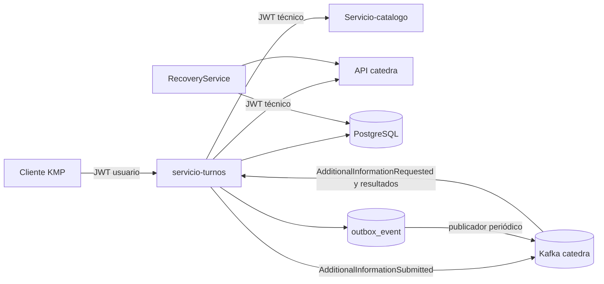

# Arquitectura

## Componentes

- `CatalogoClient`: horarios y validación de profesional.
- `CatedraClient`: ocupaciones, holds, confirmación, listado, cancelación y reconciliación.
- `AvailabilityService`: slots del catálogo menos `CONFIRMED`/`HELD` vigentes de cátedra.
- `ReservationService`: holds, confirmación, teléfono, listado y cancelación.
- `TurnosKafkaListener`: consume `alumnos.turnos.acciones.{groupId}`, valida `schemaVersion=1`, message key y `groupId`.
- `ReservationEventService`: aplica eventos de confirmación, rechazo, expiración, proceso inválido y cancelación.
- `OutboxService`: persiste `AdditionalInformationSubmitted` y lo publica con reintentos acotados.
- `RecoveryService`: expira procesos localmente y reconcilia estados antiguos contra REST.

## Modelo de datos

- `app_user`, `authority`, `user_authority`: identidad y roles.
- `reservation_process`: estado local del proceso; pertenece a un `app_user`; guarda `processId`, `holdId`, `reservationId`, `externalPatientId`, `requestEventId`, `phoneAttempt`, `patientPhone`, `expiresAt`, `reason`, `cancelledAt` y timestamps.
- `appointment_hold`: copia local del hold remoto.
- `outbox_event`: eventos pendientes/publicados/fallidos con `attempts`, `nextAttemptAt` y `lastError`.
- `processed_event`: `eventId` ya aplicado, usado para idempotencia de consumo Kafka.

La propiedad del proceso siempre es el usuario autenticado. El cliente no puede enviar `userId`, `login` ni `externalPatientId`; se deriva del JWT.

## Sincronización

- REST es la fuente para crear holds, confirmar inicialmente, listar y cancelar.
- Kafka notifica resultados y solicitudes; la message key de turnos es siempre `reservationProcessId`.
- Un timeout o respuesta perdida no se interpreta como fallo: se reconsulta `/api/appointments` por `reservationProcessId` + `externalPatientId` antes de repetir efectos.
- Los eventos tardíos no reabren estados finales (`CONFIRMED`, `EXPIRED`, `INVALID`, `CANCELLED`, `FAILED`); `AppointmentCancelled` sí puede cerrar un `CONFIRMED`.
- Los rechazos de teléfono incrementan `phoneAttempt`, por lo que el siguiente `eventId` es distinto.

## Idempotencia y recuperación

- `processed_event.eventId` evita aplicar dos veces un mismo evento Kafka.
- `outbox_event.eventId` evita duplicar `AdditionalInformationSubmitted`.
- El publicador del outbox reintenta con backoff acotado y deja rastro de `FAILED`.
- Los eventos fallidos del consumidor van al DLT `<actions-topic>.dlt` tras reintentos acotados.
- `RecoveryService` expira procesos con `expiresAt` vencido y reconcilia procesos inactivos con la API de cátedra, incluidos `CONFIRMED` para capturar cancelaciones remotas. La búsqueda remota recorre todas las páginas antes de declarar `REMOTE_NOT_FOUND`.

## Seguridad

- JWT HS256 emitido por turnos con roles `USER`, `ADMIN` y `SERVICE`.
- El JWT técnico de cátedra queda solo en el servidor y nunca se devuelve al cliente.
- Si hay credenciales de la cuenta técnica, el arranque hace login y recupera la integración vigente antes de enlazar propiedades y crear beans Kafka; si no, se usan las variables individuales.
- `/actuator/metrics` requiere `ADMIN`; `/actuator/health` es público.
- CORS expone `Authorization`, `X-Total-Count` y `Link`.

## Observabilidad

Métricas Micrometer: `turnos.kafka.events`, `turnos.outbox.events`, `turnos.recovery.processes`, `turnos.appointments.list` y `turnos.appointments.cancel`. Los logs no incluyen tokens ni teléfonos.
